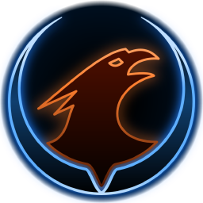

<h1 align="center">
  
   
  Xonotic
</h1>

<b>This is the snap for Xonotic</b>. It works on Ubuntu, Fedora, Debian, and other major Linux
distributions.

## Install

    sudo snap install xonotic
    sudo snap connect xonotic:joystick
    sudo snap connect xonotic:dot-xonotic

([Don't have snapd installed?](https://snapcraft.io/docs/core/install))

Xonotic is an addictive, arena-style first person shooter with crisp movement
and a wide array of weapons. It combines intuitive mechanics with in-your-face
action to elevate your heart rate. Xonotic is and will always be free-to-play.

## User data

Both the game and dedicated server use `~/.xonotic`, including `~/.xonotic/data`
for custom maps. The `dot-xonotic` personal-files plug permits reading and writing
this directory and must be connected manually as shown above. Alternatively,
run `sudo ./connect.sh` from this checkout to connect both optional interfaces.

Existing data in `~/snap/xonotic/current/.xonotic` is not moved automatically.
Before switching, stop both applications and back up both directories. Copy any
wanted data into `~/.xonotic`, taking care not to overwrite newer files.

## Contributing and testing

Open pull requests against `candidate`. Pull requests build and review the snap
on amd64 and retain the VM launch/screenshot smoke test. Merges to `candidate`
build amd64 and arm64 through Launchpad, publish to `latest/candidate`, and open
a call-for-testing issue with screenshots. Maintainers can promote the tested
revisions using the command in that issue.

    sudo snap refresh xonotic --channel=latest/candidate

Report results in the call-for-testing issue, including whether the game and
server can read and write the same `~/.xonotic/data` directory.

Versions are checked daily against the official Xonotic download page.
The packaging repository's license is [GPL-3.0](LICENSE).
